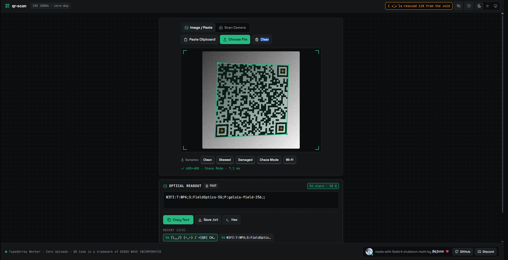

<h1>
  
  iso18004
</h1>

Zero-dependency ISO/IEC 18004 QR decoder written from scratch in TypeScript over `Uint8Array`, `Uint32Array`, and `Float64Array` buffers, paired with an off-thread SolidJS web scanner.

Live scanner and X-Ray telemetry workbench: https://qjuzo.github.io/iso18004

<p align="center">
  <a href="https://qjuzo.github.io/iso18004">
    
  </a>
</p>

## Benchmarks

Measured on `400×400` RGBA buffers in Node `v24.22.1` (30 warmup iterations, 200 timed runs per workload):

| Workload | `@qr-scan/core` p50 (p95) | `jsQR` 1.4.0 p50 (p95) | RS repairs |
| --- | --- | --- | --- |
| Clean (`V3-M`, `29×29`) | **2.22 ms** (2.53 ms) | 5.09 ms (8.08 ms) | 0B |
| Perspective skew (`V4-Q`, `33×33`) | **2.69 ms** (4.29 ms) | 6.38 ms (9.81 ms) | 0B |
| Shadow gradient (`V4-Q`, damaged) | **2.29 ms** (3.27 ms) | 6.29 ms (8.68 ms) | 6B |
| Chaos `180°` tilt + grain (`V6-H`) | **3.30 ms** (4.59 ms) | 42.33 ms (58.42 ms) | 11B |

- **Environment:** AMD Ryzen 5 5600G with Radeon Graphics (12 threads), Windows 10 (`win32` `x64`, `NT 10.0.19045.0`), Node `v24.22.1`.
- **Script:** [`scripts/bench.mts`](scripts/bench.mts) (`pnpm bench`).
- **Inputs:** Synthetic `400×400` RGBA buffers generated from the `clean`, `skewed`, `damaged`, and `chaos` presets.

## Design

- Hot loops operate directly on contiguous `Uint8Array`, `Uint32Array`, and `Float64Array` views instead of `number[]` allocations or per-pixel objects.
- `buildIntegralImage` guards 32-bit unsigned sums up to `16,843,009` pixels (`MAX_U32_INTEGRAL_PIXELS`) and switches to `Float64Array` above that limit.
- The web scanner decodes off the main thread in a Web Worker and transfers `ImageData.data.buffer` and telemetry arrays with zero-copy `Transferable` messages.
- Reproduce the `@qr-scan/core` benchmark numbers locally with `pnpm bench`.

## Usage

Use `scan()` for general images (screenshots, high-resolution photos, or camera frames). It runs a fast full-frame `decode()` pass first, downsamples oversized images via a 2x luma pyramid from coarse to fine, and falls back to overlapping upscaled/native tiles within `maxTimeMs` / `maxWindows`. Call `decode()` directly when you only want a single full-frame pass.

```ts
import { decode, scan } from '@qr-scan/core';

const result = scan(rgba, width, height, {
  tryInverted: true,
  debug: false,
  maxTimeMs: 1500,
});

if (result) {
  console.log(result.text, result.version, result.ecLevel, result.corners);
}

// Single-pass decode without pyramid or tiled fallback:
const direct = decode(rgba, width, height, { tryInverted: true });
```

## Quick start (no setup knowledge needed)

- **Windows:** run `start.bat` from the repo root. It checks for Node.js and `pnpm` (enabling `corepack` if needed), installs dependencies on first run, builds `@qr-scan/core`, and opens the local web scanner.
- **macOS / Linux:** run `./start.sh` from the repo root for the same setup and browser launch steps.

For development workflows (Node.js 22+ and `pnpm`):

```sh
pnpm install
pnpm dev     # builds @qr-scan/core and starts Vite dev server
pnpm test    # runs node --test suite in packages/core
pnpm bench   # runs 200-iteration decode benchmark
pnpm build   # builds core + web bundle
```

## Inside `packages/core`

- `binarize.ts`: BT.601 luma conversion, integral-image accumulation (`Uint32Array` / `Float64Array`), and adaptive local thresholding.
- `locator.ts`: `1:1:3:1:1` finder scanning, candidate pooling, triad ordering, alignment search, and projective corner estimation.
- `perspective.ts`: planar homography solver and bilinear sub-module grid sampler.
- `format.ts`: BCH format/version strip decoding and data mask evaluation across Versions 1–40.
- `reed-solomon.ts`: GF(256) block de-interleaving and Berlekamp-Massey / Forney error correction.
- `bitstream.ts`: Numeric, Alphanumeric, Byte (UTF-8 / ISO-8859-1 / ECI), and Shift-JIS Kanji segment decoder.
- `scan.ts`: multi-scale 2x pyramid, overlapping windowed fallback, time/window budgeting, and full-frame coordinate mapping.

## Limitations

- Standard QR symbols (Versions 1–40, EC levels L/M/Q/H, normal and inverted polarity) only; Micro QR, rMQR, and multi-symbol Structured Append reassembly are not supported.
- `scan()` aborts and returns `null` when its budget (`maxTimeMs`, default `1500` ms, or `maxWindows`) is exhausted before finding a valid code.
- Very small (`< ~1.5 px/module`), heavily motion-blurred, or near-zero-contrast symbols may fail binarization or finder detection.

---

QR Code is a registered trademark of DENSO WAVE INCORPORATED.
